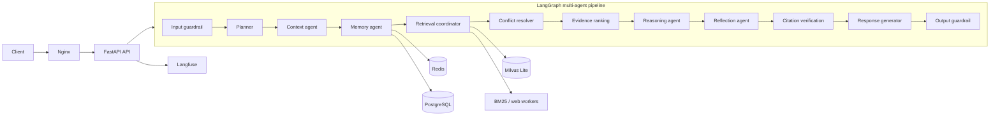

# Burkina Faso Legal AI

A production-grade **agentic AI legal research assistant** for Burkina Faso law
and regulations (national law, OHADA law, case law, official gazette). It
answers legal questions in French (and other languages) with verified,
traceable citations to real legal sources.

Design priorities, in order: **accuracy, reliability, explainability,
traceability, low hallucination**. The system refuses to guess: every
substantive statement must trace to a retrieved evidence chunk, fabricated
citations are rejected automatically, and low-confidence answers are flagged
or escalated for human review.

> **Legal disclaimer.** This system is a legal *research* aid. Its answers are
> grounded in the cited sources but do **not** constitute legal advice. Always
> consult a licensed legal professional for your specific situation.

## Features

| Capability | How it works |
|---|---|
| Multi-agent reasoning pipeline | 13-node LangGraph workflow: guardrail → planner → context → memory → retrieval → conflict resolution → evidence ranking → reasoning → reflection → citation verification → response → output guardrail |
| Grounded answers | Responses are composed strictly from retrieved evidence; every claim carries a numeric citation verified against the evidence list |
| Hybrid retrieval | Vector (Milvus) + keyword (BM25) + government/regulation/case-law/news workers, fused with RRF and authority-weighted ranking |
| Legal conflict resolution | Official source > newer amendment > timeline-in-force; unresolvable conflicts are surfaced, never silently resolved |
| Authority-weighted ranking | Constitution > OHADA treaty > amended law > law > decree > … > blog (see `backend/core/constants.py`) |
| Anti-hallucination controls | Citation verification, reflection self-critique, bounded retries (max 1), grounded-answer policy, refusal path |
| Memory | MemGPT-style tiers: short-term buffer, summaries, long-term semantic memory, user preferences |
| Durable conversations | Temporal workflows survive restarts; memory buffer is persisted |
| Security | JWT + RBAC, input/output guardrails, rate limiting, sandboxed tools, audit logging |
| Observability | Prometheus metrics, Grafana dashboards, Langfuse traces, OpenTelemetry |
| Offline-first | Production chat and embeddings use keyless local Ollama; deterministic mock chat and in-process infrastructure substitutes support tests/development without external credentials |

## Architecture



## Quickstart

### 1. Local install

```bash
python -m venv .venv
source .venv/bin/activate   # Linux/macOS
# .venv\Scripts\activate   # Windows

pip install -r requirements.txt
pip install -e .
```

### 2. Prepare keyless local Ollama

Production chat uses only Ollama running locally, without an API key. Two role
models are fixed by the server:

- **Qwen 2.5 3B** (`qwen2.5:3b`) handles language routing,
  query routing, planning, claim refinement, ingestion classification, and
  optional LLM rerank scoring.
- **Gemma 4 12B** (`gemma4:12b`) handles reasoning/reflection,
  direct/general/grounded synthesis, drafting enrichment, and memory summaries.

Users cannot select models, and environment role overrides or runtime catalog
replacement do not change these assignments. Daily quotas and anti-abuse rate
limits still apply.

Install and start Ollama on the host, then pull the chat models and the separate
embedding model:

```bash
ollama pull qwen2.5:3b
ollama pull gemma4:12b
ollama pull nomic-embed-text
```

For an API process running directly on the host, start it with local endpoints:

```bash
LEGAL_AI_LLM_PROVIDER=ollama \
LEGAL_AI_LLM_API_BASE=http://localhost:11434 \
LEGAL_AI_EMBEDDING_MODEL=ollama/nomic-embed-text \
LEGAL_AI_EMBEDDING_DIMENSION=768 \
LEGAL_AI_EMBEDDING_API_BASE=http://localhost:11434 \
LEGAL_AI_STT_PROVIDER=faster-whisper \
uvicorn backend.api.main:app --host 0.0.0.0 --port 8000
```

To persist configuration, copy `.env.example` to `.env` and edit it. `.env` is
the single configuration file; it is gitignored and should never be committed.
The deterministic `mock` chat provider is reserved for tests/development, not as
a production failover.

### 3. Full stack with Docker Compose

The containers use the same keyless Ollama service on the Docker host for chat
and embeddings. Copy the production template and fill in your secrets:

```bash
cp .env.example .env
```

The template already sets the required local AI configuration:

```ini
LEGAL_AI_LLM_PROVIDER=ollama
LEGAL_AI_LLM_API_BASE=http://host.docker.internal:11434
LEGAL_AI_LLM_API_KEY=
LEGAL_AI_EMBEDDING_MODEL=ollama/nomic-embed-text
LEGAL_AI_EMBEDDING_DIMENSION=768
LEGAL_AI_EMBEDDING_API_BASE=http://host.docker.internal:11434
LEGAL_AI_EMBEDDING_API_KEY=
LEGAL_AI_STT_PROVIDER=faster-whisper
```

Keep both API base values on `host.docker.internal` for containers; use
`localhost` only for host-run processes. Set strong application and database
secrets in `.env`. There is no external chat failover.

Start the core stack:

```bash
docker compose up -d --build
```

Start Langfuse (optional, on port 3002 to avoid conflict with the frontend):

```bash
docker compose --profile observability up -d
```

This starts the API, Celery worker, Nginx, PostgreSQL, Redis, Milvus,
Temporal (+ UI on :8080), Prometheus (:9090), Grafana (:3001) and
Langfuse (:3002).

### 4. Example request

Chat endpoints require a JWT. In `development` a dev user
`admin` / `admin123` exists (see [docs/api.md](docs/api.md)):

```bash
# 1. get a token
TOKEN=$(curl -s -X POST http://localhost:8000/api/v1/auth/token \
  -H "Content-Type: application/json" \
  -d '{"username": "admin", "password": "admin123"}' | python -c "import sys,json; print(json.load(sys.stdin)['access_token'])")

# 2. ask a question
curl -X POST http://localhost:8000/api/v1/chat \
  -H "Authorization: Bearer $TOKEN" \
  -H "Content-Type: application/json" \
  -d '{"query": "Quels sont les droits d\u0027un salarie licencie au Burkina Faso ?"}'
```

Response (abridged):

```json
{
  "session_id": "…",
  "answer": {
    "answer": "Selon le Code du travail … [1]",
    "citations": [{ "label": "Code du travail, art. 39", "verified": true }],
    "confidence": 0.82,
    "requires_human_review": false,
    "warnings": []
  },
  "trace": ["input_guardrail: allowed", "planner: 3 search tasks", "…"],
  "latency_ms": 1342.5,
  "trace_id": "<langfuse-trace-id>"
}
```

## Frontend

A Next.js 15 (App Router, TypeScript, Tailwind CSS) web UI lives in
[`frontend/`](frontend/). It provides the conversation interface with live
SSE streaming of the agent pipeline, an agent execution timeline, a citation
panel, an evidence viewer with full source metadata, and an optional JWT login
(anonymous calls work in development).

```bash
cd frontend
npm install
npm run dev          # http://localhost:3000
```

The API base URL is configurable via `NEXT_PUBLIC_API_URL`. The default behavior
proxies `/backend-api/*` server-side to `http://localhost:8000`, which avoids
CORS issues because the API does not enable CORS. Set
`NEXT_PUBLIC_API_URL=http://localhost:8000` in `frontend/.env.local` to call
the API directly when CORS is handled upstream (e.g., via Nginx).

An optional Docker service is also available:

```bash
docker compose --profile frontend up -d --build frontend
```

> Note: the `frontend` service publishes host port **3000**, which Langfuse
> also uses — adjust one of the port mappings if you run both.

## Langfuse tracing

The project integrates Langfuse via LiteLLM callbacks and a per-request
`traced_chat_run()` helper. It captures every LLM generation (model, tokens,
cost), the full LangGraph node tree, user/session IDs, feature tags, and the
sanitised final answer. User feedback is recorded as a Langfuse score.

The [Langfuse AI skill](https://github.com/langfuse/skills) is installed under
`.kimi-code/skills/langfuse/` and is used to keep the instrumentation aligned
with Langfuse best practices (descriptive trace names, environment attribute,
nested spans, meaningful input/output, and feedback scores).

## Repository layout

```
.
├── backend/
│   ├── agents/            # LangGraph node implementations (13 nodes)
│   ├── planner/           # planner agent (LLM + heuristic fallback)
│   ├── workflows/         # LangGraph graph construction & runners
│   ├── core/              # models, constants, config, context, ports, llm, cache
│   ├── retrieval/         # hybrid retrieval coordinator & workers
│   ├── vectorstore/       # Milvus adapter + in-memory fallback
│   ├── ingestion/         # document ingestion pipeline
│   ├── memory/            # MemGPT-style memory store
│   ├── guardrails/        # input/output safety checks
│   ├── sandbox/           # sandboxed tool execution
│   ├── tools/             # agent tools
│   ├── api/               # FastAPI application (REST / SSE / WebSocket)
│   ├── security/          # JWT, RBAC, rate limiting
│   ├── observability/     # Prometheus metrics, OTel, Langfuse
│   └── evaluation/        # metrics, golden dataset, runner
├── docs/                  # documentation (see below)
├── frontend/              # Next.js web UI (chat, agent timeline, citations, evidence)
├── docker/                # Dockerfile, Nginx
├── .github/workflows/     # CI
├── docker-compose.yml     # full stack
├── requirements.txt
└── pyproject.toml
```

## Documentation

- [Architecture](docs/architecture.md) — system design and component responsibilities
- [Agents](docs/agents.md) — the 13 pipeline nodes in detail
- [Workflow](docs/workflow.md) — LangGraph graph, conditional edges, retry budgets
- [Retrieval](docs/retrieval.md) — hybrid RAG pipeline and chunk metadata
- [Memory](docs/memory.md) — MemGPT-style memory tiers
- [Database](docs/database.md) — schema (ER diagram)
- [API reference](docs/api.md) — endpoints with examples
- [Deployment](docs/deployment.md) — compose topology and production checklist
- [Operations](docs/operations.md) — runbook and failure modes
- [Monitoring](docs/monitoring.md) — metrics, dashboards, alerts
- [Security](docs/security.md) — auth, guardrails, threat model
- [Load testing](docs/testing.md) — Locust and k6 examples
- [Developer guide](docs/developer.md) — extending agents, domains, retrievers
- [Administrator guide](docs/administrator.md) — users, ingestion, evaluations
- [Evaluation](docs/evaluation.md) — quality metrics and the evaluation runner

Post-upgrade (agentic platform) documentation:

- [RAG architecture](docs/RAG_ARCHITECTURE.md) — the upgraded LangGraph pipeline as implemented
- [Legal retrieval](docs/LEGAL_RETRIEVAL.md) — question types, decomposition, temporal model, ranking, coverage loop
- [Document processing](docs/DOCUMENT_PROCESSING.md) — loaders, legal chunking, classification, versioning
- [Citation system](docs/CITATION_SYSTEM.md) — citation contract, claim/citation verification, confidence model
- [Evaluation framework](docs/EVALUATION.md) — golden dataset, metrics, gates and baseline
- [Migration guide](docs/MIGRATION.md) — upgrade/rollback notes, schema migration, new settings and endpoints
- [RAG architecture audit](docs/RAG_ARCHITECTURE_AUDIT.md) — pre-upgrade audit snapshot

## Configuration

Everything is configured via environment variables prefixed `LEGAL_AI_` (see
`.env.example` for the full, commented template, plus
[deployment docs](docs/deployment.md)).

| File | Purpose | Gitignored? |
|---|---|---|
| `.env` | The single configuration file, loaded by `backend/core/config.py` | yes |
| `.env.example` | Documented template covering every setting | no |

`backend/core/config.py` loads `.env` only — there is no second override file.

## Development

Run the backend compile check and regression tests:

```bash
python -m compileall backend -q
pip install -e '.[test]'
python -m pytest tests -q
```

Run the offline RAG evaluation (CI requires at least 85% passing cases):

```bash
python -m backend.evaluation.runner \
  --dataset backend/evaluation/golden_dataset.json \
  --out data/eval/eval_report
```

Run the frontend type-check and build:

```bash
cd frontend
npm run build
```
