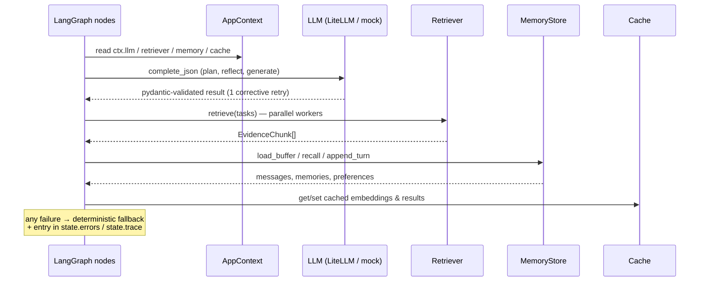

# Agents

The pipeline is a LangGraph `StateGraph` (see
[workflow.md](workflow.md) for the full graph). Every node has the signature
`async def node(state: GraphState, ctx: AppContext) -> dict` and returns
only the state keys it updates. Nodes never raise on LLM/infrastructure
failure — they degrade to deterministic behavior and append to
`errors`/`trace`.

```mermaid
flowchart LR
    q[User query] --> ig[input_guardrail]
    ig -->|allowed| lg[language_gate]
    ig -->|blocked| ref[refusal]
    lg --> qr[query_router]
    qr -->|direct/general| rg[response_generator]
    qr -->|retrieval| pl[planner]
    pl --> ca[context_agent]
    ca --> ma[memory_agent]
    ma --> fan{{"fan-out: parallel retrieval_branch per sub-question"}}
    fan --> rm[retrieval_merge]
    rm --> cr[conflict_resolver]
    cr --> pe[parent_expansion]
    pe --> er[evidence_ranking]
    er --> cva[coverage_auditor]
    cva -.->|needs_more_retrieval, retry ≤ 1| fan
    cva -->|fast lane: simple coverage ≥ 0.5; RIGHTS/PROCEDURE coverage = 1.0| rg
    cva --> ra[reasoning_agent]
    ra --> rf[reflection]
    ra -.->|needs_more_retrieval, retry ≤ 1| fan
    rf -.->|should_retry_retrieval, iteration ≤ 1| fan
    rf --> rg
    rg --> clv[claim_verification]
    rg -->|direct/general routes| og
    clv --> cv[citation_verification]
    cv --> og[output_guardrail]
    og --> a[Final answer]
    ref --> a
```

## Fixed role models

Production LLM calls use the private Afrikia provider (OpenAI-compatible,
bearer key `AFRIKIA_API_KEY`, base URL `https://afrikia.neobytech.net/v1`) with
server-fixed assignments per role — models are placed on their measured
strengths, not uniformly:
**Qwen 2.5 7B** (`qwen2.5-7b`) for language gate, context/memory, claim
refinement, LLM rerank scoring (classification role), retrieval planning,
reasoning/reflection, and all user-facing synthesis;
**gemma4-e4b** for query routing only (router role).
The assignments come from measured accuracy on the repo's benchmark suite
(`scripts/benchmark_role_models.py`), not provider labels. Re-benchmarked on
2026-10-25 over all three provider models: qwen2.5-7b is the only viable
synthesis/planning model (3/3 grounded, 4-5× faster than gemma4-e4b;
nemotron-3-nano 0/3 synthesis, 7/14 routing), while gemma4-e4b routes
questions best (14/14 vs 12/14 — qwen mis-routed "Que sais-tu du droit du
travail ?" / "C'est quoi l'OHADA ?" to GENERAL, producing ungrounded answers).
Earlier larger/newer assignments caused regressions or became unavailable
(gpt-oss-20b was removed from Afrikia; nemotron-3-nano stalled during
synthesis).
Users cannot select models, and environment role overrides or runtime catalog
changes cannot replace these assignments. There is no external chat failover;
daily quotas and anti-abuse rate limits still cover all role calls. The
`mock` provider is reserved for deterministic tests/development.

`ROLE_MODEL_CONFIGS` (`backend/core/llm.py`) is the single source for model IDs
and role defaults: role-specific token and temperature limits — 0.0 for
classification, 0.3 for planning, and a near-deterministic 0.2 for analysis
and synthesis (higher temperatures made the 7B model drift: repeating
conversation history and varying legal statements between runs). Analysis is
capped at 120 seconds and 2,048 tokens per call; synthesis keeps the larger
answer budget (4,096 tokens). The public model catalog derives its IDs from
the same constants.

Embeddings, faster-whisper STT, OCR, semantic guardrails, and cross-encoder
reranking are separate capabilities, not alternative chat role models.

## input_guardrail (`backend/agents/input_guardrail.py`)

First line of defense. Delegates to
`backend.guardrails.input_guard.check_input` to detect prompt injection,
jailbreaks, sensitive-info leaks, role hijacking and tool abuse. Produces a
`GuardrailResult` (`allowed`, `flags`, `reasons`, optional
`sanitized_query`). A blocked query routes to `refusal`; a sanitized query
replaces the original in state.

## language_gate (`backend/agents/language_gate.py`)

The corpus is French-only, so a query in another language cannot retrieve
anything. The gate detects the query language (cheap French heuristic first —
no LLM call for French) and translates non-French queries into French via the
`classification`-role LLM (`QUERY_TRANSLATE_SYSTEM`). The French text replaces
`state["query"]` for the whole downstream pipeline, the user's wording is kept
in `original_query` (shown to the response generator and persisted in history),
and `language` carries the detected code so the answer comes back in the
user's language. Fail-safe: any LLM error or unparseable output leaves the
original query untouched.

## planner (`backend/planner/agent.py`)

Converts the raw question into a `RetrievalPlan`: sub-questions, typed
`SearchTask`s (`vector`, `keyword`, `government`, `regulation`, `case_law`,
`news`, …), matched legal domains, retrieval language (French) and response
language. With a real LLM provider it uses one structured `complete` call and
validates the returned JSON (including fenced JSON); on any failure — and with
the `mock` provider — it uses `heuristic_plan`, a keyword-driven deterministic
planner that can never hallucinate. Tool-transcript output is also rejected and
falls back to that deterministic plan. Also extracts an optional `scenario_date`
for legal timeline reasoning. Independently of which path produced the plan,
the curated issue decomposition (`deterministic_decompose`, including FACTUAL
questions — "Quel est le délai de…" is the dominant real-world shape) is merged
in as a floor: broad questions always get issue-phrased keyword searches, not
just their raw keywords.

## context_agent (`backend/agents/context_agent.py`)

Loads the conversation window from the memory store
(`load_buffer(session_id, limit=20)`, i.e. the last 10 turns) so answers
stay coherent across long conversations, server restarts and workflow
interruptions. Past ASSISTANT answers are truncated much harder than user
turns (`context_assistant_max_chars` ≈ 400 vs `context_message_max_chars`
2000): they are orientation context, not a template to parrot — full-length
prior answers in the prompt caused in-session answer contamination. Prompt
consumers (reasoning_agent, response_generator) place the history block LAST,
after the question and the evidence, in a "do not repeat" frame.

## memory_agent (`backend/agents/memory_agent.py`)

MemGPT-style recall: pulls up to 5 relevant long-term semantic memories and
summaries (`ctx.memory.recall(user_id, query)`) plus the user's preferences
(`get_preferences`). These shape retrieval and the tone/language of the
answer.

## retrieval_branch / retrieval_merge (`backend/agents/retrieval_node.py`)

Retrieval is fanned out with LangGraph `Send`: **one `retrieval_branch` node
per decomposed sub-question**, all running in parallel. Each branch runs its
own vector + keyword search (plus any planned auxiliary task for its
sub-question) through `ctx.retriever` (`RetrievalCoordinator`) and writes to
the additive `branch_evidence` / `branch_trace` channels (plain state channels
cannot be written concurrently). `retrieval_merge` then fuses all branches,
deduplicates by `chunk_id`, merges with evidence already in state (retry
passes accumulate), and increments `retrieval_retries` on bounded retry
passes.

## conflict_resolver (`backend/agents/conflict_resolver.py`)

Detects chunks that disagree about the same article of the same code.
Resolution order (from the spec): (1) prefer the official government source
by authority weight, (2) prefer the latest law/amendment by publication and
effective dates, (3) for a scenario date, prefer the version in force at
that date. Each decision is recorded as a `ConflictReport` with a human-
readable `reason`; conflicts that cannot be resolved (`resolved=false`) are
surfaced in the answer instead of being guessed away.

## evidence_ranking (`backend/agents/evidence_ranking.py`)

Scores every chunk with one formula
(`0.55 × relevance + 0.30 × authority + 0.15 × confidence`, where relevance
is `max(rerank_score, retrieval_score)` and authority comes from
`AUTHORITY_WEIGHTS`). Chunks below `MIN_EVIDENCE_SCORE` (0.05) are dropped.
Output: `ranked_evidence`.

## reasoning_agent (`backend/agents/reasoning_agent.py`)

Reads only the ranked evidence, identifies what is established, what is
missing and any contradictions. May set `needs_more_retrieval` to trigger
**one** bounded retrieval retry — honored only when evidence is genuinely
thin (≤ `reasoning_retry_max_evidence` chunks) or coverage is below
`coverage_retry_threshold`, so a well-covered question never pays a double
retrieval pass. With no usable evidence it states that
explicitly instead of guessing (grounded answer policy).

## reflection (`backend/agents/reflection_agent.py`)

Self-critique before answering: did the analysis answer every part of the
question, is every claim citable, could anything be hallucinated, are there
contradictions? Produces a `ReflectionResult`. May request one retrieval
re-run (`should_retry_retrieval`), bounded by `MAX_REFLECTION_ITERATIONS=1`,
the shared retrieval retry budget, and the same sufficiency gate as the
reasoning agent (no retry when evidence is rich and coverage is high).
Falls back to a heuristic reflection without an LLM.

## claim_verification (`backend/agents/claim_verification.py`)

Post-synthesis, pre-citation-stripping pass (spec §20/§21/§44): runs between
`response_generator` and `citation_verification`. Splits the draft into
substantive statements (headings, source lists and short connectors skipped),
grades each against the evidence with deterministic heuristics
(`direct`/`indirect`/`insufficient`/`contradictory`, reusing the coverage
auditor's discriminative terms plus a conservative number-mismatch check) and
attaches the resulting `Claim` list to the `FinalAnswer`. Insufficiency
declarations (« …n'est pas couverte par les extraits [1] ») are excluded from
claims: they are status statements, not legal statements, and must not earn
citation/support credit. Insufficient claims
raise bilingual warnings; contradictory ones also set
`requires_human_review`. Recomputes
`confidence_breakdown.legal_support_confidence` as the supported-claim
fraction dampened by the contradicted share and (at half weight) the
unsupported share, then recalculates the aggregate with claim support and the
pre-draft EVIDENCE coverage — answer-text coverage is kept as diagnostic
metadata only, because an abstention that restates the question's terms must
not inflate confidence. Contradicted, LLM-unverified or abstaining answers
are capped below the serving thresholds.

With a real LLM provider (`claim_llm_refinement_enabled`, skipped for the
`mock` provider), heuristic-supported claims are then re-graded by an LLM
entailment check (`CLAIM_VERIFIER_SYSTEM`, verdicts
`explicit`/`inferred`/`unsupported`/`contradicted`) that catches what term
overlap cannot: provisions applied to a legal mechanism they do not govern
(e.g. the matrimonial-regime "passer seul un acte" article cited for a
divorce conclusion) and inexact numbers/durations. The refinement only ever
downgrades support and fails open to the heuristic grades. Claims the
refinement downgrades are recorded in `FinalAnswer.metadata`
(`inferred_claims` / `unverified_claims`) and surfaced to the user by the
output guardrail's caution note; purely heuristic flags stay dev-side
warnings (they are too noisy on paraphrased answers to show to users).

## citation_verification (`backend/agents/citation_verification.py`)

Post-synthesis judge: runs AFTER `response_generator`. Parses `[n]` citations
from the raw draft and resolves each against the actual evidence list. Verified
citations are kept; fabricated or unresolvable ones are counted before cleanup,
then removed from the answer and recorded as warnings — never silently kept.
Its verdict is synced into the `FinalAnswer` without scaling confidence twice.

## response_generator (`backend/agents/response_generator.py`)

Composes retrieval answers strictly from numbered evidence excerpts, citing
every substantive statement. Direct conversation and stable general-knowledge
routes skip retrieval and citations; general answers use model knowledge only
for concepts that do not depend on a current or jurisdiction-specific text and
receive an explicit ungrounded-note.

The prompt leads with the question, then the evidence block; conversation
history comes LAST in a "do not repeat" frame (leading with history made the
7B model repeat previous answers for the new question). One corrective retry
asks for `[n]` citations when the draft has none; a second, independent
corrective retry fires when the draft DECLARES the question uncovered although
the deterministic coverage audit says the evidence covers it
(`RESPONSE_ABSTENTION_CORRECTIVE`); a third fires when the draft CONTRADICTS
the cited excerpts on numbers/durations (`RESPONSE_CONTRADICTION_CORRECTIVE`,
naming the conflicting claim — the downstream claim_verification re-checks the
final draft). If the abstention persists, the
answerability gate (`backend/agents/answerability.py`) caps the confidence:
flat refusal → ≤ `human_review_threshold` (0.40, the low-confidence
replacement takes over); partial answer with some grounded content →
< `confidence_threshold` (0.54) so a declared gap can never display a high
badge. Caveats confined to the mandated « ## Points d'incertitude » section
are ignored — that section exists to declare gaps, so following the format is
not punished. The detection is phrase-based, accent-insensitive
(`abstention_detected` / `abstention_partial` in `FinalAnswer.metadata`), and
abstaining answers are excluded from the answer cache.

## output_guardrail (`backend/agents/output_guardrail.py`)

Final policy gate. Performs unsafe-output checks, then replaces any non-refused
retrieval answer below confidence 0.55 with a localized insufficient-information
message (citations/evidence are cleared and `low_confidence_fallback` is set).
Two exemptions keep verified content instead of the wholesale fallback:
partial answers flagged `abstention_partial` (they still answer part of the
question), and **contradiction salvage** (`salvage_contradicted_claims_enabled`):
when only SOME claims contradict the sources (and the corrective redraft already
failed upstream), the contradicted sentences are stripped, a caution note is
appended, confidence is pinned between `human_review_threshold` and 0.54, and
the verified remainder is served with `salvaged_contradiction` metadata — an
answer that was ALL contradiction still gets the fallback.
Safety refusals take precedence; direct/general routes are not subject to that
retrieval-confidence fallback. Sufficiently grounded answers receive the
appropriate legal disclaimer (French/English). When claim verification flagged
deductions or unverifiable statements
(`FinalAnswer.metadata["inferred_claims"]` / `["unverified_claims"]`), a
bilingual caution note is appended to the answer body before the disclaimer —
this note is user-facing and survives the production wiping of internal
warnings.

## refusal (`backend/agents/refusal.py`)

Terminal node for blocked queries. Returns a `FinalAnswer` with
`refused=true`, the guardrail flags and a bilingual explanation.

## Interaction with shared services

